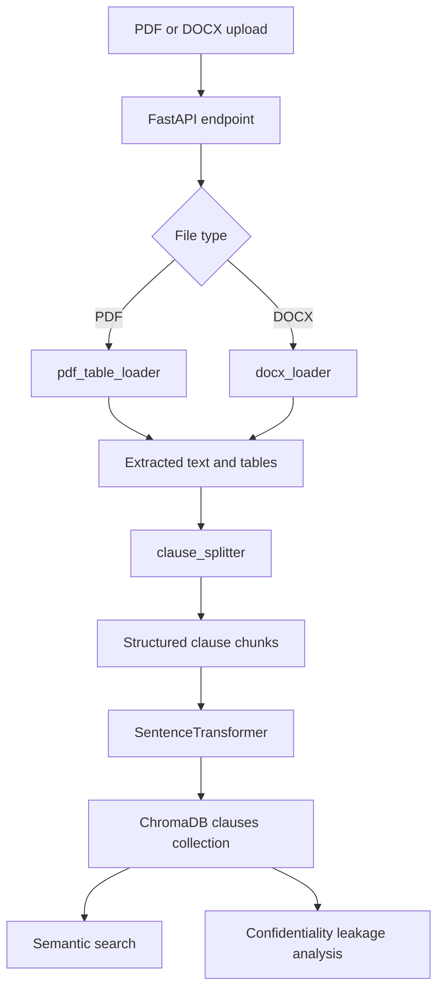

# Legal Document Intelligence (LDI) Pipeline

LDI is the document-processing and semantic-search layer of the legal-risk-compliance application. It accepts PDF and DOCX files, extracts their text and tables, identifies legal clauses, creates vector embeddings, persists them in ChromaDB, and exposes semantic search through FastAPI.

The application also mounts a confidentiality-leakage API. That API analyzes clauses that have already been indexed by LDI.

## End-to-end flow



### 1. Start the API

The application object is defined in `app/main.py`. It registers the LDI endpoints and includes the `/confidentiality` router.

```powershell
uvicorn ldi.app.main:app --reload
```

Run this command from the repository root, with the project environment active. The API is then available at `http://127.0.0.1:8000`. FastAPI's interactive documentation is available at `/docs`.

### 2. Upload and extract a document

The API writes each upload to a temporary file named `temp_<filename>`. The file is passed to the appropriate loader:

- PDF files use `ingestion/pdf_table_loader.py` and `pdfplumber`.
- DOCX files use `ingestion/docx_loader.py` and `python-docx`.

Each loader returns the same shape:

```json
{
  "text": "document text...",
  "tables": [["Column A", "Column B"]]
}
```

The temporary file is removed in a `finally` block after processing.

### 3. Inspect extracted content with `/ingest/`

`POST /ingest/` extracts text and tables from one PDF or DOCX and returns them. It does not create clause chunks or embeddings.

This is useful for checking whether document extraction succeeded before indexing.

### 4. Split text into legal clauses

`chunking/clause_splitter.py` parses extracted text line by line and maintains a hierarchy stack. It recognizes:

- Section headings such as `ARTICLE 1 DEFINITIONS` or `Schedule A`.
- Numbered clauses such as `1.`, `2.1`, and `2.1.1`.
- Lettered subclauses such as `(a)` or `b.`.
- Roman-numeral subclauses such as `(i)`.
- Quoted definitions such as `"Effective Date" means ...`.
- Unanchored text, which receives IDs such as `P1`, `P2`, and so on.

Each chunk normally contains:

```json
{
  "clause_id": "1.2.A",
  "section": "ARTICLE 1 DEFINITIONS",
  "level": "subclause",
  "text": "..."
}
```

The parser also performs post-processing:

1. Extracts table-shaped text so table rows do not disrupt clause parsing.
2. Repairs likely broken PDF lines using semantic similarity when the embedding model is available.
3. Packs small preamble chunks.
4. Merges short headings into their first child.
5. Packs small sibling clauses while preserving the merged clause IDs in the text.
6. Merges short child clauses into a parent where possible.
7. Splits chunks larger than 300 words into numbered parts.

`POST /chunk/` runs extraction and clause splitting for one file. `POST /chunk-multi/` does the same for multiple files and returns counts for clauses and tables. These endpoints return chunks for inspection; they do not persist anything.

### 5. Index clauses with `/embed-multi/`

`POST /embed-multi/` runs the indexing path for one or more uploaded files:

1. Extract text and tables.
2. Split the extracted text into clauses.
3. Convert each extracted table into a table chunk with a `TABLE_<number>` ID.
4. Embed every non-empty chunk using `all-MiniLM-L6-v2`.
5. Store vectors, text, and metadata in ChromaDB.
6. Register the document hash and filename.
7. Return the number of indexed clauses.

Vector IDs use this format:

```text
<file_name>::<clause_id>
```

Duplicate IDs receive a numeric suffix so that every ChromaDB record remains unique.

The document hash is a SHA-256 digest of the ordered clause IDs, sections, levels, and text. If the same content has already been indexed, the embedding step is skipped and the response reports `"status": "cached"`.

Example response:

```json
[
  {
    "filename": "nda.docx",
    "clauses_indexed": 18,
    "status": "success"
  }
]
```

There is an older single-file `/embed/` implementation in `app/main.py`, but it is commented out. The active indexing endpoint is `/embed-multi/`.

### 6. Persist vectors and document metadata

`embeddings/vector_store.py` creates or opens a persistent ChromaDB client using:

- Directory: `./chroma`
- Collection: `clauses`

Each stored item contains its embedding, original text, and metadata such as:

- `clause_id`
- `section`
- `level`
- `file_name`
- `document_hash`
- Optional definition, term, or table context fields

The vector store also maintains `chroma/document_hash_cache.json`. This cache maps filenames to content hashes and is used to avoid re-embedding unchanged documents and to resolve all clauses belonging to a document.

Because the paths are relative, `./chroma` is resolved from the process working directory. Start the API from the repository root if you want it to use the repository's existing `chroma` directory consistently.

### 7. Search indexed clauses

`POST /search/` accepts:

```json
{
  "query": "What are the termination rights?",
  "k": 5
}
```

The search flow is:

1. Open the ChromaDB `clauses` collection.
2. Return an empty result if the query is blank or the collection has no records.
3. Encode the query with the same `all-MiniLM-L6-v2` model used for clauses.
4. Retrieve a larger candidate set, up to `max(k * 5, 25)` results.
5. If the query mentions tables, rows, columns, or tabular data, search table chunks first and fall back to the full collection if necessary.
6. Detect whether the query mentions an indexed filename or document stem.
7. Move matches from the mentioned document ahead of other matches.
8. Format table text using pipe-separated columns.
9. Return the first `k` results.

The response shape is:

```json
{
  "results": [
    {
      "clause_id": "S1.2",
      "section": "ARTICLE 1 DEFINITIONS",
      "level": "subclause",
      "file_name": "nda.docx",
      "text": "...",
      "score": 0.31
    }
  ]
}
```

The `score` is the distance returned by ChromaDB. Lower values generally indicate closer vector matches.

### 8. Run confidentiality analysis on indexed documents

The confidentiality router is mounted at `/confidentiality` and operates on chunks already stored in ChromaDB.

First list indexed documents:

```http
GET /confidentiality/documents
```

Then analyze one by filename:

```http
POST /confidentiality/analyze
Content-Type: application/json

{
  "doc_id": "nda.docx"
}
```

The `ConfidentialityLeakageAgent` loads all clauses for that filename and runs detectors for:

- Regex-based sensitive patterns
- Personally identifiable information
- Sensitive personal data
- Confidential business information
- Named entities
- Processing activities

It classifies and aggregates findings, calculates a risk score and risk level, and returns findings linked back to clause IDs and sections. If the filename is not indexed, the endpoint returns HTTP 404.

This analysis is downstream of indexing. It does not upload, extract, chunk, or embed documents itself.

## API endpoint summary

| Endpoint | Input | Processing | Persists data |
| --- | --- | --- | --- |
| `POST /ingest/` | One PDF/DOCX | Extract text and tables | No |
| `POST /ingest-multi/` | Multiple PDF/DOCX files | Extract text and tables | No |
| `POST /chunk/` | One PDF/DOCX | Extract and split clauses | No |
| `POST /chunk-multi/` | Multiple PDF/DOCX files | Extract and split clauses | No |
| `POST /embed-multi/` | Multiple PDF/DOCX files | Extract, split, embed, store | Yes |
| `POST /search/` | JSON query and `k` | Semantic retrieval | Reads only |
| `GET /confidentiality/documents` | None | List indexed documents | Reads only |
| `POST /confidentiality/analyze` | Indexed filename | Detect and score sensitive data | Reads only |

Unsupported file types are returned as errors by the multi-file endpoints and as an error object by the single-file inspection endpoints.

## File-by-file guide

### Application

- `app/main.py`: FastAPI application, upload handling, endpoint definitions, and route registration.
- `pipeline.py`: Reserved top-level orchestration module. It is currently empty; the active orchestration is implemented directly in the API endpoint handlers.

### Ingestion

- `ingestion/pdf_table_loader.py`: Extracts page text and native PDF tables with `pdfplumber`.
- `ingestion/docx_loader.py`: Extracts DOCX paragraphs and tables with `python-docx`.
- `ingestion/cleaner.py`: Provides `clean_text`, a whitespace normalizer. It is currently not called by the API path.

### Chunking

- `chunking/clause_splitter.py`: Main hierarchical legal-clause parser and final chunk-size guard.
- `chunking/grammar.py`: Regular expressions and heuristics for headings, numbering, definitions, preamble boundaries, and table rows.
- `chunking/table_extraction.py`: Detects table-shaped text embedded in extracted lines and turns it into table chunks.
- `chunking/postprocess.py`: Merges and packs small headings, preambles, children, and sibling chunks.
- `chunking/semantic_repair.py`: Uses sentence embeddings to merge lines that appear to be continuations of the same thought; includes a lightweight fallback when the model is unavailable.

### Embeddings and storage

- `embeddings/embedder.py`: Loads SentenceTransformers and converts clause text to NumPy vectors.
- `embeddings/pipeline.py`: Computes document hashes, skips cached documents, builds IDs and metadata, embeds chunks, and writes them to the store.
- `embeddings/vector_store.py`: Owns ChromaDB persistence, upserts, document registration, document listing, and document-level clause retrieval.

### Search

- `search/pipeline.py`: Small public wrapper around the retriever.
- `search/retriever.py`: Encodes queries, performs ChromaDB searches, handles table-first intent, detects mentioned documents, re-ranks results, and formats output.

### Output and explainability extension points

- `schemas/outputs.py`: Reserved for shared LDI response schemas. It is currently empty; the active confidentiality schemas live under `agents/confidentiality_leakage/schemas.py`.
- `explainability/explain.py`: Reserved for explanation-generation logic. It is currently empty and is not called by the active API.
- `explainability/__init__.py`: Package marker.
- `config/settings.py`: Reserved for centralized configuration. It is currently empty, so model names and Chroma paths remain in module constructors.

### Tests and development utilities

- `tests/test_chunk_quality.py`: Runs PDF extraction and clause splitting, calculates average chunk size and adjacent-sentence semantic coherence, and writes `chunk_quality_report.csv`.
- `tests/test_confidentiality_document_resolution.py`: Verifies filename-based clause loading and indexed-document listing for the confidentiality agent.
- `tests/test_delete_chroma_collection.py`: Utility for deleting the development/test ChromaDB collection. Use carefully because it removes indexed data.
- `tests/__init__.py`: Test package marker.

## Installation

From the repository root:

```powershell
python -m venv venv
.\venv\Scripts\Activate.ps1
pip install -r ldi/requirements/ldi.txt
```

The requirements file installs the API, document loaders, embedding model, ChromaDB, spaCy, and pytest dependencies. The configured embedding model, `all-MiniLM-L6-v2`, is downloaded by SentenceTransformers the first time it is used.

## Running tests

Run the tests from the `ldi` directory because the chunk-quality test uses package paths relative to that directory:

```powershell
cd ldi
pytest
```

The chunk-quality test loads PDFs from `ldi/tests/sample legal docs/`, evaluates semantic coherence and chunk sizes, and may create `ldi/tests/chunk_quality_report.csv`.

## Operational notes and current limitations

- Only PDF and DOCX uploads are supported.
- Uploads are written to temporary files using the original filename. Ensure the API process has write permission in its working directory.
- The active API has no authentication, upload-size limit, or background job queue.
- Embedding and model loading are synchronous inside request handlers, so large documents can make requests slow.
- ChromaDB and the document hash cache use relative paths.
- The extraction tables returned by `/ingest` and `/chunk` come directly from the document loaders. The indexing path separately adds table chunks from the extracted text returned by the loader; table behavior should be verified for documents whose tables are not represented in text.
- `cleaner.py`, `config/settings.py`, `pipeline.py`, `schemas/outputs.py`, and `explainability/explain.py` are currently extension points rather than active stages.
- Re-indexing identical clause content is cached by content hash. Changing the document filename alone registers the new filename but does not create another set of vectors.

## Minimal workflow

```text
1. Start uvicorn.
2. POST a PDF or DOCX to /embed-multi/.
3. GET /confidentiality/documents to confirm the filename is indexed.
4. POST a natural-language query to /search/.
5. POST the indexed filename to /confidentiality/analyze for document-level leakage findings.
```
